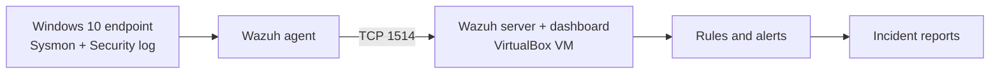
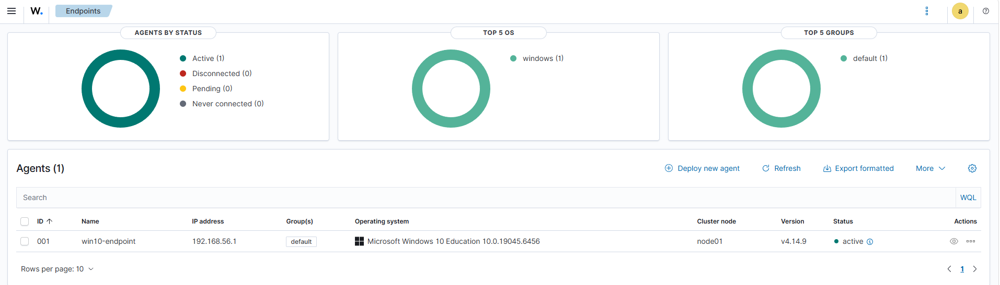
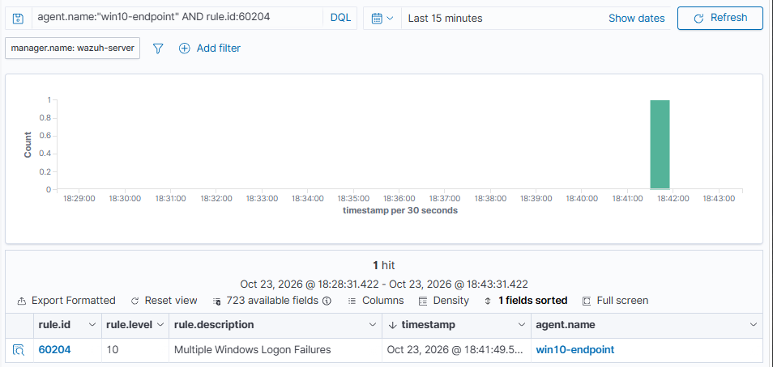
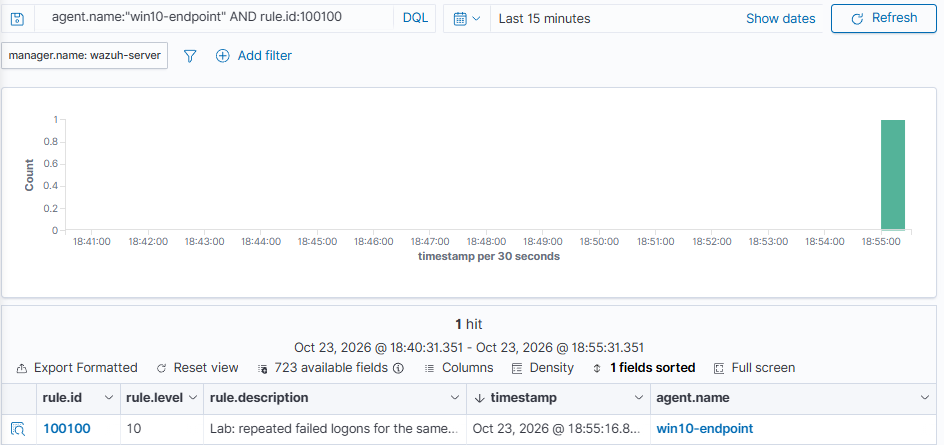
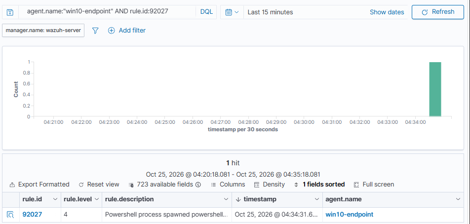
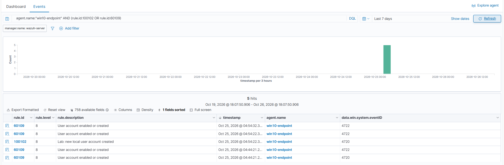

# Windows SIEM Detection Lab (Wazuh + Sysmon)

A small, reproducible detection-engineering lab. Windows endpoint telemetry (Sysmon and the Windows Security log) is collected by Wazuh, three suspicious-behavior scenarios are tested with benign commands, and each is investigated in an evidence-backed incident report. I tested Wazuh's built-in rules first, then wrote three custom rules where they left gaps or produced noise.

> All activity was generated on my own lab machine with harmless commands and test accounts. No malware and no external targets were used.

## Key results

| Measure | Result |
|---|---|
| Scenarios executed | 3 (repeated failed logons, PowerShell execution policy bypass, local account creation) |
| Controlled test runs | 9 (4 failed-logon bursts, 3 PowerShell runs, 2 account-lifecycle runs) |
| Custom rules written | 3 (100100, 100101, 100102). Each fired on real lab events. |
| Dedicated negative tests | 2 (3 failed logons, and PowerShell without the bypass flag). Neither triggered its custom rule. |
| Incident reports | 3 |
| Built-in rule problems documented | 4 (a threshold gap, a low-severity rule that ignores the command line, duplicate alerts with a mismatched ATT&CK mapping, and several false positives) |

Three to four short runs per scenario do not measure detection accuracy against real attacks. See [Limitations](#limitations-and-future-work).

## Architecture



The endpoint is a physical Windows 10 laptop, not a VM, because the host has 8 GB of RAM. The Wazuh server is the official all-in-one OVA running in VirtualBox on the same laptop, connected over a host-only network.

## Technology stack

Wazuh 4.14.9 (OVA), VirtualBox, Windows 10 Education, Sysmon with the [SwiftOnSecurity configuration](https://github.com/SwiftOnSecurity/sysmon-config), Windows Security event log, MITRE ATT&CK. The SwiftOnSecurity file is downloaded during setup and is not included in this repository.

## Repository layout

```
README.md
docs/detection-matrix.md      every detection, its test, and its result
rules/custom-rules.xml        my three custom rules
incidents/                    three incident reports
tests/samples/                sanitized sample alerts, one per rule
evidence/                     sanitized screenshots
```

## Setup

Prerequisites: VirtualBox, a Windows 10 machine to monitor, and about 25 GB of free disk for the Wazuh VM.

1. **Wazuh server.** Download the OVA from the Wazuh documentation (I used 4.14.9) and import it into VirtualBox. I set 4 GB of RAM and 2 CPUs, the **VMSVGA** graphics controller, **Hardware Clock in UTC Time**, and a **Host-only** network adapter. Log in with the OVA's documented default credentials, and change them for anything beyond a lab.
2. **Wazuh agent.** In the dashboard, use **Deploy new agent** and run the generated command in an administrator PowerShell on the endpoint. It has this form:
   ```
   Invoke-WebRequest -Uri <agent MSI URL> -OutFile $env:tmp\wazuh-agent; msiexec.exe /i $env:tmp\wazuh-agent /q WAZUH_MANAGER='<server IP>' WAZUH_AGENT_NAME='win10-endpoint'
   NET START Wazuh
   ```
3. **Sysmon.** Download Sysmon from Microsoft Sysinternals and the SwiftOnSecurity config, then install:
   ```
   .\Sysmon64.exe -accepteula -i sysmonconfig.xml
   ```
4. **Collect the Sysmon channel.** Add this block to `C:\Program Files (x86)\ossec-agent\ossec.conf` just above the final `</ossec_config>`, then run `Restart-Service -Name wazuh`:
   ```
   <localfile>
     <location>Microsoft-Windows-Sysmon/Operational</location>
     <log_format>eventchannel</log_format>
   </localfile>
   ```
   The agent already reads the Security log by default.
5. **Auditing.** Failed-logon events (4625) were already being produced. To make both settings explicit:
   ```
   auditpol /set /subcategory:"Logon" /success:enable /failure:enable
   auditpol /set /subcategory:"User Account Management" /success:enable /failure:enable
   ```
6. **Custom rules.** Append the contents of `rules/custom-rules.xml` to `/var/ossec/etc/rules/local_rules.xml` on the Wazuh server, check them with `/var/ossec/bin/wazuh-analysisd -t`, and restart with `systemctl restart wazuh-manager`.
7. **Known issue: full disk.** On the 25 GB OVA disk, the vulnerability-detection feed unpacked about 9.3 GB into `/var/ossec/tmp` and again under `/var/ossec/queue/vd`. The disk filled, Filebeat logged `no space left on device`, and the dashboard stopped showing new alerts. I stopped the manager, deleted the temporary file, and set `<enabled>no</enabled>` inside `<vulnerability-detection>` in `/var/ossec/etc/ossec.conf`, because that feature is out of scope here. Free space stayed at about 9.5 GB after restarts.

## Detection coverage

| Scenario | Data source | Built-in rule | Custom rule | Tests | Result |
|---|---|---|---|---|---|
| Repeated failed logons | Security 4625 | 60122 (level 5), 60204 (level 10, 8 failures in 240 s) | 100100 (level 10, 5 failures in 120 s per account) | 6, 10, 6, and 3 failures | 60204 fired at 10 failures and not at 6. 100100 fired at 6 and not at 3. |
| PowerShell execution policy bypass | Sysmon Event ID 1 | 92027 (level 4) | 100101 (level 10) | baseline, positive, negative | 100101 fired with the flag and not without it. |
| Local account creation | Security 4720, 4722 | 60109 (level 8, T1098) | 100102 (level 8, T1136.001) | create/delete, create/disable/enable/delete | 100102 fired once per creation. 60109 produced two alerts per creation. |

Full details, severity rationale, and gaps for each row are in [`docs/detection-matrix.md`](docs/detection-matrix.md).

## Incident investigations

- [INC-001: repeated failed logons](incidents/incident-001.md). The built-in correlation rule needs 8 failures, so a 6-failure burst produced only level-5 alerts. The custom rule closed that gap for the burst tested.
- [INC-002: PowerShell with execution policy bypass](incidents/incident-002.md). The built-in rule ignores the command line and fires at level 4 either way. The custom rule matches the bypass flag.
- [INC-003: local account creation](incidents/incident-003.md). One account creation produced two identical-looking built-in alerts mapped to a technique that does not fit. The custom rule alerts once and maps to T1136.001.

## Evidence

Sanitized screenshots (more in [`evidence/`](evidence/)):


*The Windows endpoint registered with the Wazuh server and reporting as active.*


*Built-in rule 60204 firing after a 10-failure burst.*


*Custom rule 100100 firing on a 6-failure burst.*


*Scenario 2: built-in rule 92027 on each run, and custom rule 100101 on the bypass run only.*


*Scenario 3: custom rule 100102 on account creation alongside built-in rule 60109 on the enable events.*

## Testing methodology

- Benign activity only, generated on my own lab machine, with a nonexistent account for failed logons and a clearly named temporary account (`labtest_user3`) that I deleted after each run.
- Each test was timed with `Get-Date` before and after, and PowerShell tests used a unique marker string so events were easy to find.
- Failed-logon counts were cross-checked against the Windows Security log (10, 6, and 3 events for the three bursts I counted).
- Every custom rule was checked with `wazuh-analysisd -t`, deployed, and then tested with real events from the lab, not only a rule-testing tool.
- Timelines use event times from the endpoint where I inspected them. Wazuh alert timestamps use the server clock and differed slightly.

Commands used:

```
1..6 | ForEach-Object { net use \\localhost\IPC$ /user:labtest_fake WrongPass123 }
powershell.exe -NoProfile -ExecutionPolicy Bypass -Command "Write-Output 'LAB-S2-TEST'"
powershell.exe -NoProfile -Command "Write-Output 'LAB-S2-NEG'"
net user labtest_user3 * /add
net user labtest_user3 /delete
```

## Limitations and future work

- **One endpoint, one account, small samples.** Each detection was tested against a handful of runs, and thresholds (5 failures in 120 seconds, level 10) are my choices, not tuned against realistic traffic.
- **Physical endpoint.** The endpoint is my own laptop, so tests were limited to harmless activity, and logs and screenshots needed sanitizing (hostname, username, and SIDs were replaced).
- **Source analysis was not meaningful.** Every failed logon came from the loopback address.
- **Not covered:** `pwsh.exe`, encoded PowerShell, `Set-ExecutionPolicy`, group-membership changes (event 4732), domain accounts, and other account-creation tools.
- **Delivery backlog.** After the Wazuh VM had been off for about a day, the agent delivered a batch of old events and Wazuh raised the queue-flooded alert (rule 204). I believe some events could be dropped in that situation, so a missing alert right after a restart is not proof that nothing happened.
- **Clock skew.** The Wazuh server clock ran about half a second to two seconds off from the endpoint in the events I compared.
- **Telemetry that would help:** PowerShell Script Block Logging (event 4104), process-creation context for account changes, and group-membership events.
- **Next steps:** tune the custom rules against more realistic background activity, add exclusions, and add an automated test script.

## Sanitization and credits

Sample alerts and reports have the hostname, username, and account SIDs replaced (`LAB-ENDPOINT`, `labuser`, `S-1-5-21-REDACTED`). No credentials or full VM images are included. Built with [Wazuh](https://wazuh.com), [Sysmon](https://learn.microsoft.com/sysinternals/downloads/sysmon) from Microsoft Sysinternals, the [SwiftOnSecurity Sysmon configuration](https://github.com/SwiftOnSecurity/sysmon-config), and the [MITRE ATT&CK](https://attack.mitre.org) knowledge base.

## License

MIT License for my original rules and documentation. See `LICENSE`.
